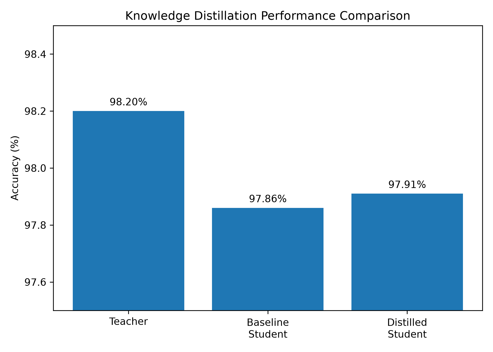

# Knowledge Distillation from Scratch in PyTorch

> I create easy-to-follow, hands-on tutorials covering Machine Learning, Neural Network Architectures, PyTorch implementations, and real-world AI applications.
>
> 👉 **[Click here to Subscribe to @EjegiOgbemi](https://www.youtube.com/@EjegiOgbemi)** and never miss an update!

---

## 📌 Overview

This repository provides a clean, modular, and educational implementation of **Knowledge Distillation** based on Geoffrey Hinton's seminal 2015 paper, [*Distilling the Knowledge in a Neural Network*](https://arxiv.org/abs/1503.02531).

Knowledge Distillation is a model compression technique where a compact **Student** network is trained to replicate the performance of a deeper, more expressive **Teacher** network by learning from the teacher's soft probability outputs ("dark knowledge").

### Why Knowledge Distillation?
- **Speed & Latency**: Smaller models process inferences drastically faster on edge devices and CPUs.
- **Memory Footprint**: A compressed model requires significantly less RAM and storage.
- **Superior Generalization**: The student trained with soft targets often outperforms the same student trained purely on hard one-hot labels.

---

## 🏗️ Architecture Comparison

In this project, we test Knowledge Distillation on the **MNIST** dataset:

| Model | Architecture | Parameter Count | Relative Size | Test Accuracy |
| :--- | :--- | :---: | :---: | :---: |
| **TeacherNet** | 5-layer MLP (784 &rarr; 1024 &rarr; 512 &rarr; 256 &rarr; 128 &rarr; 10) | ~1,494,154 (~1.49M) | **14.7x larger** | **98.20%** |
| **Baseline Student** | 2-layer MLP (784 &rarr; 128 &rarr; 10) | ~101,770 (~102K) | 1.0x (Baseline) | **97.86%** |
| **Distilled Student** | 2-layer MLP (784 &rarr; 128 &rarr; 10) | ~101,770 (~102K) | **1.0x (Identical)** | **97.91%** 🚀 |

> The distilled student achieves a noticeable performance boost over the baseline student **without adding a single extra parameter or FLOPS** at inference time.

---

## 📊 Performance Comparison



---

## 📁 Repository Structure

```plaintext
knowledge-distillation/
│
├── data/                         # Automatically downloaded MNIST dataset (git-ignored)
├── accuracy_comparison.png        # Performance comparison bar chart
├── engine.py                     # Training loops, evaluation, and distillation epoch engine
├── evaluate.py                   # Standalone evaluation script for the teacher model
├── losses.py                     # Hinton's Knowledge Distillation loss function
├── models.py                     # TeacherNet and StudentNet model definitions
├── requirement.txt               # Project dependencies
├── requirements.txt              # Project dependencies alias
├── student_baseline.pth          # Saved weights for baseline student
├── student_distilled.pth         # Saved weights for distilled student
├── teacher.pth                   # Saved weights for teacher model
├── test_data.py                  # Sanity check script for MNIST dataloader
├── test_models.py                # Sanity check script for model forward passes
├── train_student.py              # Script to train student from scratch (baseline)
├── train_teacher.py              # Script to train the teacher model
├── trained_distilled_student.py  # Script to train student via Knowledge Distillation
├── utils.py                      # DataLoader helpers for MNIST
└── visualize.py                  # Script to plot and save accuracy comparison chart
```

---

## 🚀 Getting Started

### 1. Clone the Repository
```bash
git clone https://github.com/ogbemi-ejegi/knowledge-distillation.git
cd knowledge-distillation
```

### 2. Set Up a Virtual Environment (Recommended)
```bash
# On Windows
python -m venv venv
venv\Scripts\activate

# On macOS/Linux
python3 -m venv venv
source venv/bin/activate
```

### 3. Install Dependencies
```bash
pip install -r requirement.txt
```

> **Note for GPU / CUDA Acceleration:**
> If you have an NVIDIA GPU, install PyTorch with CUDA support from the [official PyTorch website](https://pytorch.org/get-started/locally/):
> ```bash
> pip install torch torchvision --index-url https://download.pytorch.org/whl/cu121
> ```

---

## 💻 How to Run

### Step 1: Train the Teacher Model
Train the 5-layer `TeacherNet` on MNIST for 10 epochs. The trained weights will be saved to `teacher.pth`.
```bash
python train_teacher.py
```

### Step 2: Train the Baseline Student Model
Train the lightweight `StudentNet` directly on MNIST without any teacher guidance (standard cross-entropy). Saved to `student_baseline.pth`.
```bash
python train_student.py
```

### Step 3: Train the Distilled Student
Train `StudentNet` using teacher guidance via Hinton's distillation loss ($T=3, \alpha=0.7$). Saved to `student_distilled.pth`.
```bash
python trained_distilled_student.py
```

### Step 4: Evaluate Models
Verify the teacher or student accuracy on the test set:
```bash
python evaluate.py
```

### Step 5: Visualize the Results
Generate the accuracy comparison chart:
```bash
python visualize.py
```

---

## 🤝 Connect & Follow

If you found this repository helpful, please consider **starring ⭐️ this repository** and subscribing to my channel!

- **YouTube**: [@EjegiOgbemi](https://www.youtube.com/@EjegiOgbemi)
- **GitHub**: [@ogbemi-ejegi](https://github.com/ogbemi-ejegi)

Have questions, suggestions, or want to collaborate? Feel free to open an issue or connect on YouTube!
